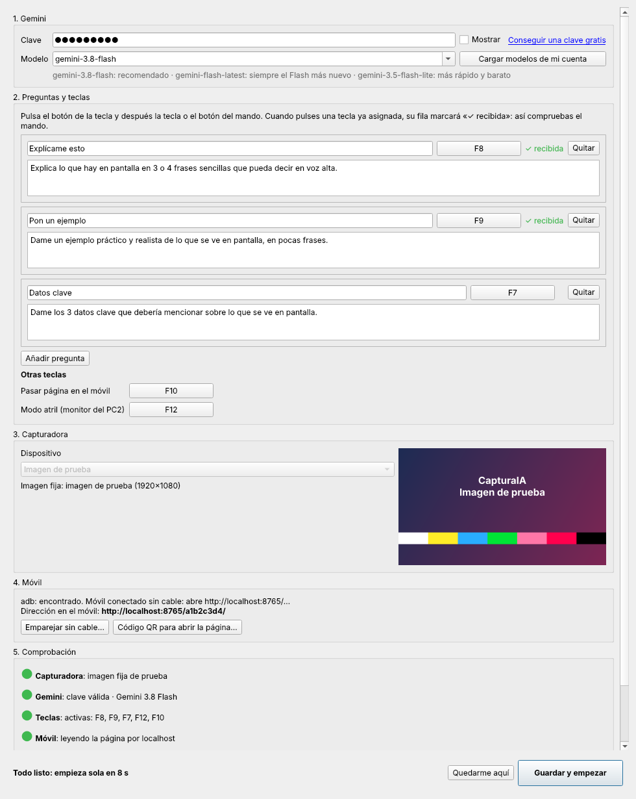

# Guía rápida de CapturaIA

Tu montaje, sin alternativas: trabajas en la ASUS como siempre y lees las respuestas de Gemini en
el móvil, sin cable.

## Cómo funciona

```
Portátil del trabajo ──HDMI──▶ splitter ──▶ ASUS (aquí trabajas y te graba la cámara)
                                       └──▶ capturadora ──USB──▶ PC2 (debajo de la mesa)
PC2 ──(F8)──▶ Gemini ──respuesta──▶ PC2 ──depuración inalámbrica──▶ móvil junto a la ASUS
```

1. El portátil manda la imagen a la ASUS y el splitter manda una copia a la capturadora.
   **El portátil no se entera de nada** y no se le instala nada.
2. El PC2 recibe esa imagen todo el rato, pero no hace nada con ella.
3. Pulsas **F8** en el mando: el PC2 coge la imagen de ese momento y se la manda a Gemini con
   tu pregunta.
4. Gemini responde en unos segundos.
5. La respuesta aparece en el móvil.

Todo eso lo hace CapturaIA sola. Tú solo pulsas el botón y lees.

---

## Una sola vez (en este orden)

**Preparar el PC2**

1. Instala **uv** (abre PowerShell y pega):
   `powershell -ExecutionPolicy ByPass -c "irm https://astral.sh/uv/install.ps1 | iex"`
2. Descarga CapturaIA (el ZIP del repositorio en GitHub) y entra en la carpeta `capturaia`.
3. Descarga **«SDK Platform-Tools for Windows»** de
   <https://developer.android.com/tools/releases/platform-tools> y descomprímelo **dentro de la
   carpeta `capturaia`**. Tiene que quedar `capturaia\platform-tools\adb.exe`.
4. Conecta el PC2 a la **segunda entrada de la ASUS** (HDMI o DisplayPort) y déjalo así.
   - Cuando quieras ver el PC2, cambia la entrada de la ASUS; luego vuelve a la del portátil.
   - Si la ASUS solo tiene una entrada, usa un adaptador «HDMI dummy» en el PC2.
5. Para que CapturaIA arranque sola con el PC2: pulsa Win+R, escribe `shell:startup` y deja
   ahí un acceso directo a `Iniciar CapturaIA.cmd`.
6. Doble clic en **`Iniciar CapturaIA.cmd`**. La primera vez tarda un par de minutos.
   Se abre la **pantalla de inicio**.

**En la pantalla de inicio** (todo se guarda solo)



7. **Gemini:**
   - Pega tu clave (gratis en <https://aistudio.google.com/apikey>).
   - Deja el modelo recomendado, o pulsa «Cargar modelos de mi cuenta» para elegir otro.
8. **Preguntas y teclas:**
   - Cambia los nombres y los textos de las preguntas si quieres, o añade más.
   - Para asignar un botón del mando, pulsa el botón de la tecla de esa fila y luego el botón
     del mando.
   - Cuando pulses un botón ya asignado, su fila marca «✓ recibida».
9. **Capturadora:** elige la Cam Link. A la derecha verás la imagen del portátil.
10. **Móvil:**
    - Activa las Opciones para desarrolladores del Pixel: Ajustes ▸ Información del teléfono ▸
      pulsa **7 veces** en «Número de compilación».
    - Activa Opciones para desarrolladores ▸ **Depuración inalámbrica**. Truco: en esas mismas
      opciones, añade «Depuración inalámbrica» a los ajustes rápidos («Iconos para
      desarrolladores en ajustes rápidos») y la activarás con un toque.
    - Pulsa **«Emparejar sin cable…»** y, en el móvil, Depuración inalámbrica ▸ «Vincular
      dispositivo con código de vinculación». Escribe la IP:puerto y el código de 6 cifras.
    - Pulsa **«Código QR para abrir la página…»**, escanéalo con el móvil y, en Chrome,
      ⋮ ▸ **Añadir a pantalla de inicio**.
11. **Comprobación:**
    - Los cinco puntos deben estar en verde: Capturadora, Gemini, Teclas, Móvil y Pantalla del
      móvil.
    - Pulsa «Pregunta de prueba» para ver una respuesta de verdad (también llega al móvil).
12. Pulsa **«Guardar y empezar»**.

**El mando (8BitDo o similar)**

13. Ponlo en **modo teclado** y empareja por Bluetooth con el **PC2** (no con el móvil). Que
    sus botones envíen teclas (F7, F8, F9, F10…) y asígnalas en la pantalla de inicio (paso 8).

Para volver a la pantalla de inicio desde la app: **Archivo ▸ Pantalla de inicio**.

---

## Cada día de grabación

- [ ] Enciende el PC2 (CapturaIA arranca sola, en la pantalla de inicio).
- [ ] Móvil en la wifi de casa, con el **cargador** puesto.
- [ ] Activa **Depuración inalámbrica** (Android la apaga al reiniciar o cambiar de wifi).
- [ ] Abre el icono de CapturaIA, pon el móvil **en horizontal** y **toca la pantalla una vez**.
      Pasa a pantalla completa y ya no se apaga.
- [ ] En el móvil verás «Pantalla de inicio del PC2: comprobando…» y, cuando todo esté en
      verde, «Todo listo. Empieza en 10 s…». A los 10 s pasa a **«Listo. Pulsa una tecla para
      preguntar.»**, sin avisos en rojo ni la nota amarilla «La pantalla puede apagarse».
- [ ] Si en el móvil sale en rojo «Revisa la pantalla de inicio del PC2: …», cambia la entrada
      de la ASUS al PC2, arregla lo que esté en rojo, pulsa «Guardar y empezar» y vuelve a la
      entrada del portátil.
- [ ] Haz un **F8 de prueba** con la primera diapositiva y mira que llega la respuesta.
- [ ] A grabar. Gemini tarda unos segundos, así que ten una frase puente preparada («Esto es
      importante, fijaos bien…»).

---

## Si algo falla

**Si falla algo mientras grabas, sigue dando el curso.** La grabación del portátil no se ve
afectada; solo pierdes la ayuda en ese momento.

| Lo que ves en el móvil | Qué hacer |
|---|---|
| «Sin conexión con CapturaIA» (rojo) | Comprueba que el PC2 está encendido y que **Depuración inalámbrica** sigue activada; reactívala si se apagó. Se reconecta sola en unos segundos. |
| «Sin señal de la capturadora» | Revisa el cable HDMI que va del splitter a la capturadora y el USB de la capturadora al PC2. Se reconecta sola. |
| «Revisa la pantalla de inicio del PC2: …» | La app no ha arrancado sola porque algo está en rojo (lo dice el aviso). Cambia la entrada de la ASUS al PC2 y arréglalo ahí. |
| «Gemini no está listo: …» | La clave de Gemini falta o no es válida, o el PC2 no tiene internet. Revisa la clave en la pantalla de inicio (Archivo ▸ Pantalla de inicio). |
| «Teclas: …» | Hay una tecla repetida o el PC2 no ha podido activarlas. Revísalas en la pantalla de inicio; si sigue, cierra CapturaIA y vuelve a abrirla con `Iniciar CapturaIA.cmd`. |
| «La pantalla puede apagarse» (amarillo, abajo) | Toca la pantalla una vez. Si sigue, cierra y abre la página desde el icono: tiene que ser la dirección `localhost`. |
| Pulsas el mando y no pasa nada (sin ningún aviso) | Mira que el mando esté encendido y emparejado con el **PC2**, y que sus botones envíen F8/F9/F7. Para comprobarlo, pulsa F8 en un teclado conectado al PC2. |
| La respuesta no cabe | Pulsa **F10** para pasar página. |

---

## Recuerda

- Solo sale a internet la imagen del momento en que pulsas, y va del PC2 a Gemini.
  **No pulses nunca con datos personales de ciudadanos en pantalla.**
- Revisa que tu organismo permite enviar el contenido de los cursos a un servicio externo.
- La referencia completa (todas las opciones) está en el [README](README.md).
