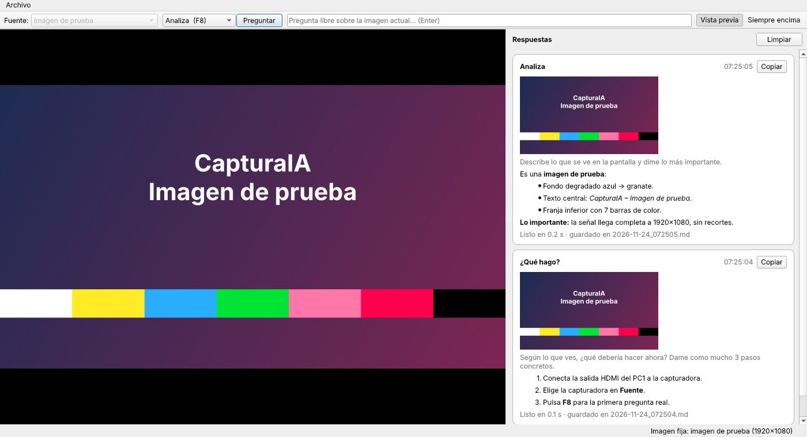

# CapturaIA

Pulsas una tecla, la app coge el frame actual de la **capturadora**, se lo manda a **Gemini**
con una pregunta prefijada y la respuesta aparece en un **panel lateral**.

Pensada para un montaje con dos PCs:

```
PC1 ──HDMI──▶ capturadora ──USB/PCIe──▶ PC2 (CapturaIA) ──▶ API de Gemini
```

- En el PC1 no se instala nada. Para él, la capturadora es un monitor más, así que su coste es
  prácticamente cero.
- No hace falta OBS: CapturaIA lee la capturadora directamente y muestra la vista previa.
- La tecla se pulsa en un periférico del **PC2**: teclado, ratón con botones extra, macro pad o
  Stream Deck. Funciona aunque la ventana no esté en primer plano.



## Instalación en el PC2 (Windows)

1. **Instala uv**, que gestiona Python y las dependencias. En PowerShell:
   ```powershell
   powershell -ExecutionPolicy ByPass -c "irm https://astral.sh/uv/install.ps1 | iex"
   ```
2. **Descarga el código.** Con git: `git clone` del repo. También puedes bajar el ZIP desde
   GitHub. Después entra en la carpeta `capturaia`.
3. **Consigue una API key de Gemini** (gratis) en <https://aistudio.google.com/apikey> y
   guárdala como variable de entorno:
   ```powershell
   setx GEMINI_API_KEY "tu-clave"
   ```
   Cierra y vuelve a abrir la terminal para que se aplique.
4. **Arranca la app:** doble clic en `Iniciar CapturaIA.cmd`, o desde la terminal:
   ```powershell
   uv run capturaia
   ```
   La primera vez, uv descarga Python y las dependencias, así que tarda un par de minutos.

**Antes de arrancar:** si OBS u otro programa está usando la capturadora, ciérralo. La mayoría
de capturadoras solo se dejan abrir por un programa a la vez.

## Uso

| Acción | Cómo |
|---|---|
| Preguntar con la pregunta 1 | **F8** (o botón «Preguntar») |
| Preguntar con la pregunta 2 | **F9** |
| Pregunta libre | Escríbela en la barra y pulsa Enter |
| Elegir capturadora | Desplegable «Fuente» (recuerda la última) |
| Dejar solo el panel | Desmarca «Vista previa» y estrecha la ventana |
| Ventana por encima de todo | «Siempre encima» |
| Ver capturas y respuestas guardadas | Archivo ▸ Abrir carpeta de capturas |
| Cambiar preguntas, teclas o modelo | Archivo ▸ Editar configuración… (y reinicia la app) |

Las respuestas aparecen mientras Gemini las escribe, con la más reciente arriba. Cada tarjeta
tiene un botón «Copiar».

Cada captura se guarda como `.jpg` junto a un `.md` con la pregunta y la respuesta. Por defecto
van a `%APPDATA%\capturaia\capturas`. Se puede desactivar en `[history]`.

Para probar sin capturadora: `uv run capturaia --demo`, que usa una imagen de prueba.
`uv run capturaia --demo foto.png` usa la imagen que le pases.

## Configuración

El archivo está en `%APPDATA%\capturaia\config.toml`. Se crea solo la primera vez, con todos
los valores comentados. Puedes verlo en [`config.example.toml`](config.example.toml).
Lo más habitual:

```toml
[gemini]
model = "gemini-3.8-flash"      # o "gemini-flash-latest", "gemini-3.5-flash-lite" (más rápido)
thinking_level = "low"          # minimal / low / medium / high: más alto = mejor pero más lento

[capture]
device = "HD60"                 # parte del nombre de tu capturadora (ver: uv run capturaia --list-devices)

[[presets]]
name = "Analiza"
hotkey = "<f8>"
prompt = "Describe lo que se ve en la pantalla y dime lo más importante."

[[presets]]
name = "Resumen rápido"
hotkey = "<ctrl>+<alt>+r"
prompt = "Resume en una frase lo que está pasando."
```

Puedes añadir tantos `[[presets]]` como quieras, cada uno con su tecla. Formato de teclas:

- Teclas sueltas: `<f8>`.
- Combinaciones: `<ctrl>+<alt>+g`, `<shift>+<f9>`.
- **F13–F24** no existen en un teclado normal, pero se pueden asignar en un Stream Deck o un
  macro pad. Así nunca chocan con otros programas.

## Problemas frecuentes

**No se ve imagen o sale «No encuentro…».**
- Mira los nombres con `uv run capturaia --list-devices` y pon uno en `[capture] device`.
- Comprueba que ningún otro programa (OBS, la app de la capturadora…) la tiene abierta.
- En Windows, revisa **Configuración ▸ Privacidad y seguridad ▸ Cámara ▸ Permitir que las
  aplicaciones de escritorio accedan a la cámara**. Las capturadoras cuentan como cámara.
- Si sigue fallando, prueba el modo OpenCV (DirectShow):
  ```powershell
  uv sync --extra opencv
  ```
  Después, en `config.toml`: `backend = "opencv"` y `device = "0"`. Si no es esa, prueba `"1"`,
  `"2"`… Si la imagen sale mal, prueba `fourcc = "MJPG"` o `"YUY2"`.

**La tecla no hace nada.**
- Si el programa que tiene el foco en el PC2 se ejecuta como administrador, Windows no deja que
  otras apps vean sus teclas. Arranca CapturaIA también como administrador, o usa F13–F24.
- Otro programa puede estar usando la misma tecla. Cámbiala en `[[presets]]`.
- La barra de estado de la ventana avisa si alguna tecla no es válida o está repetida.

**Errores de Gemini** (aparecen en la propia tarjeta):
- «límite de peticiones»: la cuota gratuita tiene límites por minuto y por día. Espera o cambia a
  un modelo Flash-Lite.
- «el modelo … no existe»: revisa `model` en la configuración.
- «API key no válida»: revisa `GEMINI_API_KEY`.

**Privacidad:** las capturas se envían a Google. En el nivel gratuito de la API, Google puede
usar ese contenido para mejorar sus productos; en el de pago, no. No captures pantallas con
datos sensibles.

## Desarrollo

```bash
uv sync --extra opencv
QT_QPA_PLATFORM=offscreen uv run pytest
uv run ruff check src tests && uv run ruff format --check src tests
```

Estructura:

| Archivo | Qué hace |
|---|---|
| `capture/` | Fuentes de vídeo intercambiables: `qt_source` (Qt Multimedia, por defecto), `opencv_source` (DirectShow) e `image_source` (imagen fija). |
| `gemini.py` | Manda imagen + pregunta y devuelve el texto en streaming. |
| `hotkeys.py` | Teclas globales con pynput. |
| `ui/` | Ventana principal y panel de respuestas. |
| `history.py` | Guarda capturas y respuestas en disco. |
| `config.py` | Lee y valida `config.toml`. |
