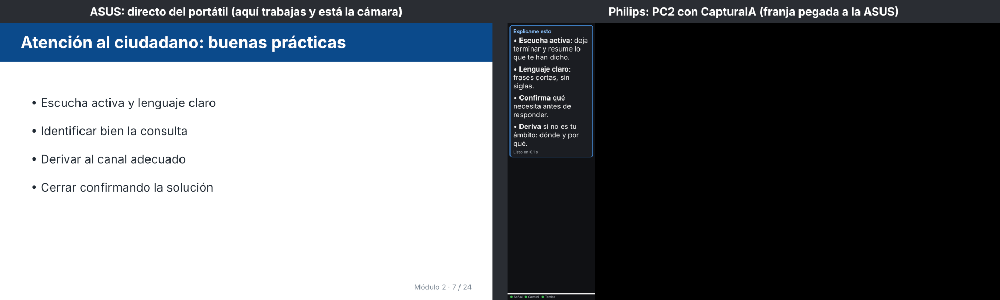
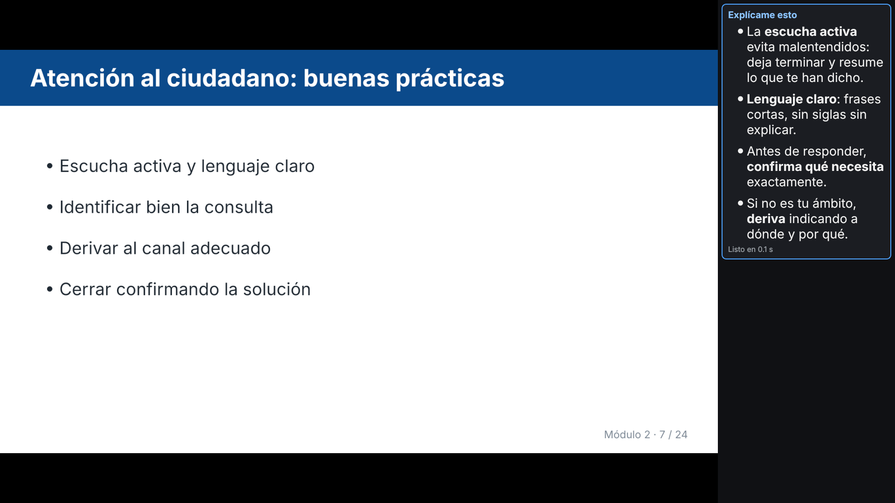
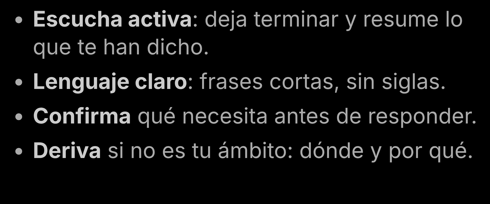

# CapturaIA

> **¿Primera vez? Empieza por la [Guía rápida](GUIA-RAPIDA.md):** tu montaje paso a paso, la lista de cada día de grabación y qué hacer si algo falla.

Pulsas una tecla, la app coge el frame actual de la **capturadora**, se lo manda a **Gemini**
con una pregunta prefijada y la respuesta aparece en un **panel lateral**.

Pensada para un montaje con dos PCs:

```
PC1 ──HDMI──▶ capturadora ──USB/PCIe──▶ PC2 (CapturaIA) ──▶ API de Gemini
```

- En el PC1 no se instala nada. Para él, la capturadora es un monitor más, así que su coste es
  prácticamente cero.
- No hace falta OBS: CapturaIA lee la capturadora directamente y muestra la vista previa.
- La tecla se pulsa en un periférico del **PC2**: teclado, ratón con botones extra, macro pad o
  Stream Deck. Funciona aunque la ventana no esté en primer plano.


## Instalación en el PC2 (Windows)

1. **Instala uv**, que gestiona Python y las dependencias. En PowerShell:
   ```powershell
   powershell -ExecutionPolicy ByPass -c "irm https://astral.sh/uv/install.ps1 | iex"
   ```
2. **Descarga el código.** Con git: `git clone` del repo. También puedes bajar el ZIP desde
   GitHub. Después entra en la carpeta `capturaia`.
3. **Consigue una API key de Gemini** (gratis) en <https://aistudio.google.com/apikey> y
   guárdala como variable de entorno:
   ```powershell
   setx GEMINI_API_KEY "tu-clave"
   ```
   Cierra y vuelve a abrir la terminal para que se aplique.
4. **Arranca la app:** doble clic en `Iniciar CapturaIA.cmd`, o desde la terminal:
   ```powershell
   uv run capturaia
   ```
   La primera vez, uv descarga Python y las dependencias, así que tarda un par de minutos.

**Antes de arrancar:** si OBS u otro programa está usando la capturadora, ciérralo. La mayoría
de capturadoras solo se dejan abrir por un programa a la vez.

## Uso

| Acción | Cómo |
|---|---|
| «Explícame esto» | **F8** (o botón «Preguntar») |
| «Pon un ejemplo» | **F9** |
| «Datos clave» | **F7** |
| Entrar/salir del modo atril (pantalla completa) | **F12** (dentro del modo, también **Esc**) |
| Pasar página en la franja de respuestas | **F10** (al final vuelve arriba) |
| Pregunta libre | Escríbela en la barra y pulsa Enter |
| Elegir capturadora | Desplegable «Fuente» (recuerda la última) |
| Dejar solo el panel | Desmarca «Vista previa» y estrecha la ventana |
| Ventana por encima de todo | «Siempre encima» |
| Ver las respuestas en el móvil | Archivo ▸ Conectar el móvil (código QR) |
| Ver capturas y respuestas guardadas | Archivo ▸ Abrir carpeta de capturas |
| Cambiar preguntas, teclas o modelo | Archivo ▸ Editar configuración… (y reinicia la app) |

Las respuestas aparecen mientras Gemini las escribe, con la más reciente arriba. Cada tarjeta
tiene un botón «Copiar».

Cada captura se guarda como `.jpg` junto a un `.md` con la pregunta y la respuesta. Por defecto
van a `%APPDATA%\capturaia\capturas`. Se puede desactivar en `[history]`.

Para probar sin capturadora: `uv run capturaia --demo`, que usa una imagen de prueba.
`uv run capturaia --demo foto.png` usa la imagen que le pases.

## Grabar cursos: modo atril

Pensado para dar un curso grabándote sin cortes, con ayuda de Gemini, y sin que nada de eso
salga en el vídeo:

- **Trabajas en tu monitor de siempre** (la ASUS), conectado directamente al portátil: sin
  retraso, a tamaño completo, con la cámara encima. Ahí clicas, pones vídeos y presentas.
- **El monitor del PC2** (el Philips), justo al lado, enseña solo una **franja fina** con las
  respuestas, pegada al borde que toca la ASUS. El resto queda en negro. Basta un vistazo corto.
- Si el PC2, la capturadora o Gemini fallan a mitad de curso, **la grabación sigue igual**:
  solo pierdes la ayuda en ese momento.



### Montaje

```
Portátil ──HDMI──▶ splitter (EDID COPY, con cargador) ──OUT1──▶ ASUS (trabajas aquí, cámara encima)
                                                      └─OUT2──▶ Cam Link 4K ──USB 3──▶ PC2 ──▶ Philips (franja)
```

- **La imagen va solo por cable.** El portátil manda la señal por su HDMI y el splitter la
  copia. La capturadora la convierte a USB y el PC2 la recibe. No hay red de por medio: no se
  instala nada en el portátil y el PC2 no puede leer nada de él, solo recibe la imagen.
- **Lo que ves en la ASUS es exactamente lo que recibe la capturadora.** Si trabajas solo con
  la ASUS (tapa cerrada o sin usar la pantalla del portátil), no hay que tocar nada en Windows.
  - Win+P ▸ «Duplicar» solo haría falta si usaras a la vez la pantalla del portátil, y también
    va por cable.
  - La opción «Conectar a una pantalla inalámbrica» del mismo menú sí iría por wifi, y aquí
    **no se usa**.
- **Lo único que sale a internet** es lo que el PC2 envía a Gemini cuando pulsas una tecla: la
  captura de ese momento y la pregunta. Antes de usarlo:
  - Comprueba que la política de tu organismo permite enviar a un servicio externo el
    contenido que se ve en pantalla.
  - No pulses nunca con datos personales de ciudadanos en pantalla.
  - Si no quieres guardar copias en el PC2, pon `[history] enabled = false`.
- **El PC2** no necesita estar en la red del trabajo. Basta con que tenga internet propio.

### Puesta en marcha

1. Arranca CapturaIA en el PC2 y elige la Cam Link en «Fuente». La app la recuerda.
2. Arrastra la ventana al Philips y pulsa **F12**: pasa a pantalla completa en negro, con la
   franja a la izquierda. Si tu Philips estuviera a la izquierda de la ASUS, pon
   `side = "right"` en `[presenter]`.
3. Para arrancar siempre así, pon `start = true` en `[presenter]` o usa
   `uv run capturaia --presentar`.
4. Ajusta en `[presenter]`:
   - `strip_width`: ancho de la franja (340 px por defecto).
   - `font_size`: tamaño de letra (20 por defecto).
5. Para disparar sin soltar el ratón del portátil, conecta al PC2 un **pedal USB** o un teclado
   numérico pequeño y asígnale las teclas (F7–F10, F12, o F13–F24 si el pedal lo permite). Un
   pedal además no se oye en la grabación.
6. Las respuestas están pensadas para leerse de reojo: como mucho unas 5 viñetas cortas con la
   palabra clave en negrita. Gemini tarda unos segundos, así que ten preparada una frase puente
   («Esto es importante, fijaos bien…»).

### Antes de grabar: los tres puntos verdes

Abajo de la franja hay tres indicadores:

| Indicador | Verde | Rojo |
|---|---|---|
| **Señal** | Llega imagen de la capturadora | No llega: aviso en rojo arriba y reconexión automática cada pocos segundos |
| **Gemini** | Clave y modelo comprobados al arrancar | Falta la clave, no es válida o no hay conexión (el motivo sale arriba en rojo) |
| **Teclas** | Teclas globales activas | Alguna tecla no vale o está repetida |

**Graba solo con los tres en verde.** Si se pierde la señal, la app no envía nada a Gemini
(vería una imagen antigua) y te lo dice en la franja.

### Alternativa: ver también la imagen del portátil en el Philips

Con `show_video = true` en `[presenter]`, el Philips muestra además la imagen del portátil, con
la franja al lado. Sirve para mirar el Philips en vez de la ASUS. Ten en cuenta que:
- La imagen sale algo más pequeña en un monitor 16:9 y con un pequeño retraso.
- Dependes de que el PC2 no falle.

Para cursos en los que tienes que clicar con precisión, es mejor el modo atril.

<details><summary>Cómo queda con imagen (16:9 y 21:9)</summary>




</details>

## Respuestas en el móvil (sin segundo monitor)

En vez del segundo monitor, puedes leer las respuestas en el **móvil**, puesto con un cuello de
cisne pegado a tu monitor, casi en la línea de la cámara. El PC2 se queda debajo de la mesa,
sin pantalla.



```
Portátil ──HDMI──▶ splitter ──OUT1──▶ ASUS (trabajas aquí, cámara encima, móvil al lado)
                            └─OUT2──▶ Cam Link ──USB──▶ PC2 (sin monitor) ──cable USB o wifi──▶ móvil
```

- **Sin apps ni cuentas:** el móvil abre en Chrome una página que sirve el propio PC2, por
  cable o por tu wifi. Las respuestas no pasan por ningún servidor de fuera. La dirección lleva
  una clave aleatoria para que otro aparato de la red no pueda leerla.
- **Solo se ve la respuesta**, la última, pensada para el móvil en horizontal. La letra se ajusta
  sola: tan grande como quepa (hasta el máximo que elijas) y, si la respuesta es larga, se
  reduce para que entre entera. Si aun así no cabe, **F10** también pasa página en el móvil.
- **Fondo negro puro y texto gris suave.**
- **Al tocar la pantalla:**
  - El primer toque la pone a pantalla completa (sin la barra de Chrome) y bloquea la pantalla
    encendida.
  - Cada toque muestra unos segundos los controles: tamaño máximo de letra (A−/A+), brillo del
    texto (☀−/☀+), el estado de la pantalla y los indicadores. El móvil recuerda lo que elijas.
- **Avisos solo si algo falla,** en rojo arriba: sin conexión con el PC2, sin señal de la
  capturadora, Gemini no listo o teclas que no funcionan. Si la pantalla puede apagarse, sale
  una nota amarilla pequeña en una esquina. Si todo va bien, no ves nada más que la respuesta.

### Conectar el móvil: tres formas

| | Dirección en el móvil | ¿IP fija o chrome://flags? | Pantalla siempre encendida |
|---|---|---|---|
| **1. Cable USB** (recomendada) | `http://localhost:8765/…` (no cambia nunca) | No | Sí, sola (y además carga el móvil) |
| **2. Sin cable, emparejado** | `http://localhost:8765/…` (no cambia nunca) | No | Sí, sola |
| **3. Wifi con la IP del PC2** | `http://192.168.x.x:8765/…` | Sí, las dos | Solo tras el ajuste de Chrome |

Las formas 1 y 2 usan **adb**, una herramienta oficial de Google para conectar el ordenador
con el móvil. Se instala una vez en el PC2:

1. Descarga «SDK Platform-Tools for Windows» de
   <https://developer.android.com/tools/releases/platform-tools>.
2. Descomprime el ZIP **dentro de la carpeta `capturaia`**, de forma que quede
   `capturaia\platform-tools\adb.exe`. No hay que instalar nada más: CapturaIA lo encuentra
   sola.
3. En el móvil, activa las Opciones para desarrolladores (Ajustes ▸ Información del teléfono ▸
   pulsa 7 veces en «Número de compilación»).

#### 1. Por cable USB

1. Ajustes ▸ Sistema ▸ Opciones para desarrolladores ▸ activa **Depuración USB**.
2. Conecta el móvil al PC2 con un cable USB lo bastante largo para llegar al cuello de cisne.
   La primera vez, acepta en el móvil «¿Permitir depuración USB?» marcando «Permitir siempre».
3. Abre en Chrome del móvil la dirección `http://localhost:8765/…` que sale en
   Archivo ▸ Conectar el móvil (o escanea el QR). Añádela a la pantalla de inicio
   (⋮ ▸ Añadir a pantalla de inicio) y ya no tendrás que volver a escribirla.

Cada vez que enchufes el móvil, CapturaIA lo prepara sola en unos segundos. Además, el cable lo
carga mientras grabas.

#### 2. Sin cable, emparejado una vez

Es como emparejar algo por Bluetooth, pero va por tu wifi. El móvil y el PC2 tienen que estar
en la misma.

1. En el PC2: **Archivo ▸ Emparejar el móvil sin cable**.
2. En el móvil: Opciones para desarrolladores ▸ **Depuración inalámbrica** ▸ actívala ▸
   «Vincular dispositivo con código de vinculación».
3. Escribe en CapturaIA la IP:puerto y el código de 6 cifras que muestra el móvil, y pulsa
   «Emparejar».
4. Abre `http://localhost:8765/…` en el móvil, como en la forma 1.

Después, cada vez que el móvil tenga activada la Depuración inalámbrica y esté en tu wifi,
CapturaIA lo conecta sola. Si Android la desactiva (al cambiar de wifi o al reiniciar), basta
con volver a activar el interruptor; no hace falta emparejar de nuevo.

Sin cable el móvil no carga, así que ponle su cargador si vas a grabar mucho rato.

> ¿Y por Bluetooth? No compensa. Como red, el PC2 podría acabar saliendo a internet por los
> datos del móvil y seguirías necesitando una IP. Y una página que hable por Bluetooth también
> exige que sea «segura». La forma 2 es el equivalente práctico.

#### 3. Por wifi con la IP del PC2 (sin adb)

1. Abre la dirección `http://IP-del-PC2:8765/…` de Archivo ▸ Conectar el móvil, con el móvil
   en la misma wifi. Si Windows pregunta si deja a Python acceder a la red, acepta **solo
   para redes privadas**.
2. Para que la pantalla no se apague, Chrome necesita que marques esa dirección como segura:
   - En `chrome://flags`, busca **Insecure origins treated as secure**.
   - Escribe la dirección sin la parte final (p. ej. `http://192.168.1.20:8765`).
   - Ponlo en **Enabled** y pulsa **Relaunch**.

   Si el router le cambia la IP al PC2, hay que repetirlo. Por eso son mejores las formas 1 y 2.

### Que la pantalla del móvil no se apague

- **Con las formas 1 y 2** la página bloquea la pantalla encendida ella sola. Al tocarla, abajo
  debe poner **«Pantalla fija»** en verde. Si sale «La pantalla puede apagarse» en amarillo,
  no está activo.
- **Refuerzo:** con el móvil cargando, activa **«Pantalla activa»** en Opciones para
  desarrolladores. Así no se apaga mientras carga.
- **Brillo:** bájalo. Con fondo negro, el Pixel apenas emite luz y no te ilumina la cara.
- **iPhone:** Ajustes ▸ Pantalla y brillo ▸ Bloqueo automático ▸ Nunca.

### El PC2 sin monitor

- **Conéctalo a la otra entrada de la ASUS** (HDMI o DisplayPort) y déjalo así. Windows sigue
  «viendo» un monitor y no hace cosas raras por no tener pantalla. Cuando necesites ver el PC2,
  cambia la entrada de la ASUS y vuelve después a la del portátil. Si tu monitor no tiene dos
  entradas, un adaptador «HDMI dummy» (unos 5–8 €) hace lo mismo.
- **Que CapturaIA arranque sola:** Win+R ▸ `shell:startup` y deja ahí un acceso directo a
  `Iniciar CapturaIA.cmd`.
- **El móvil hace de pantalla de estado del PC2.** Si al abrir la página pone «Listo. Pulsa
  una tecla para preguntar.» y no hay avisos en rojo, todo funciona: capturadora, Gemini y
  teclas. No hace falta escritorio remoto.
- **Antes de grabar, haz una pregunta de prueba** con F8 y comprueba que la respuesta llega al
  móvil.

### Lanzar las preguntas sin tocar nada visible

Empareja con el **PC2** (no con el móvil) un mando pequeño con modo teclado, como algunos
8BitDo (Micro, Zero 2…; comprueba que el modelo tenga «keyboard mode»), o un pedal USB. Con su
programa, asigna a los botones F8, F9, F7, F10 (pasar página) y F12. CapturaIA ya los entiende
como teclas globales.

### ¿Y quitar también el PC2, con la capturadora enchufada al móvil?

El móvil puede **ver** la capturadora con una app de cámara USB, pero eso solo muestra la
pantalla del portátil en el móvil: **no genera respuestas**. Hacerlo todo en el móvil
(capturar, preguntar a Gemini y mostrar) exigiría una app de Android hecha a medida.
Además:
- Con la capturadora en el único USB-C, haría falta un adaptador con carga para que no se
  quede sin batería.
- El móvil se calentaría en sesiones largas.

Para grabaciones que tienen que salir bien a la primera, el PC2 sin monitor es más fiable: hace
el trabajo pesado enchufado a la corriente, y el móvil solo muestra texto.

## Configuración

El archivo está en `%APPDATA%\capturaia\config.toml`. Se crea solo la primera vez, con todos
los valores comentados. Puedes verlo en [`config.example.toml`](config.example.toml).
Lo más habitual:

```toml
[gemini]
model = "gemini-3.8-flash"      # o "gemini-flash-latest", "gemini-3.5-flash-lite" (más rápido)
thinking_level = "low"          # minimal / low / medium / high: más alto = mejor pero más lento

[capture]
device = "HD60"                 # parte del nombre de tu capturadora (ver: uv run capturaia --list-devices)

[[presets]]
name = "Analiza"
hotkey = "<f8>"
prompt = "Describe lo que se ve en la pantalla y dime lo más importante."

[[presets]]
name = "Resumen rápido"
hotkey = "<ctrl>+<alt>+r"
prompt = "Resume en una frase lo que está pasando."
```

Puedes añadir tantos `[[presets]]` como quieras, cada uno con su tecla. Formato de teclas:

- Teclas sueltas: `<f8>`.
- Combinaciones: `<ctrl>+<alt>+g`, `<shift>+<f9>`.
- **F13–F24** no existen en un teclado normal, pero se pueden asignar en un Stream Deck o un
  macro pad. Así nunca chocan con otros programas.

## Problemas frecuentes

**No se ve imagen o sale «No encuentro…».**
- Mira los nombres con `uv run capturaia --list-devices` y pon uno en `[capture] device`.
- Comprueba que ningún otro programa (OBS, la app de la capturadora…) la tiene abierta.
- En Windows, revisa **Configuración ▸ Privacidad y seguridad ▸ Cámara ▸ Permitir que las
  aplicaciones de escritorio accedan a la cámara**. Las capturadoras cuentan como cámara.
- Si sigue fallando, prueba el modo OpenCV (DirectShow):
  ```powershell
  uv sync --extra opencv
  ```
  Después, en `config.toml`: `backend = "opencv"` y `device = "0"`. Si no es esa, prueba `"1"`,
  `"2"`… Si la imagen sale mal, prueba `fourcc = "MJPG"` o `"YUY2"`.

**La tecla no hace nada.**
- Si el programa que tiene el foco en el PC2 se ejecuta como administrador, Windows no deja que
  otras apps vean sus teclas. Arranca CapturaIA también como administrador, o usa F13–F24.
- Otro programa puede estar usando la misma tecla. Cámbiala en `[[presets]]`.
- La barra de estado de la ventana avisa si alguna tecla no es válida o está repetida.

**Errores de Gemini** (aparecen en la propia tarjeta):
- «límite de peticiones»: la cuota gratuita tiene límites por minuto y por día. Espera o cambia a
  un modelo Flash-Lite.
- «el modelo … no existe»: revisa `model` en la configuración.
- «API key no válida»: revisa `GEMINI_API_KEY`.

**Privacidad:** las capturas se envían a Google. En el nivel gratuito de la API, Google puede
usar ese contenido para mejorar sus productos; en el de pago, no. No captures pantallas con
datos sensibles.

## Desarrollo

```bash
uv sync --extra opencv
QT_QPA_PLATFORM=offscreen uv run pytest
uv run ruff check src tests && uv run ruff format --check src tests
```

Estructura:

| Archivo | Qué hace |
|---|---|
| `capture/` | Fuentes de vídeo intercambiables: `qt_source` (Qt Multimedia, por defecto), `opencv_source` (DirectShow) e `image_source` (imagen fija). |
| `gemini.py` | Manda imagen + pregunta y devuelve el texto en streaming. |
| `hotkeys.py` | Teclas globales con pynput. |
| `ui/` | Ventana principal y panel de respuestas. |
| `history.py` | Guarda capturas y respuestas en disco. |
| `config.py` | Lee y valida `config.toml`. |
